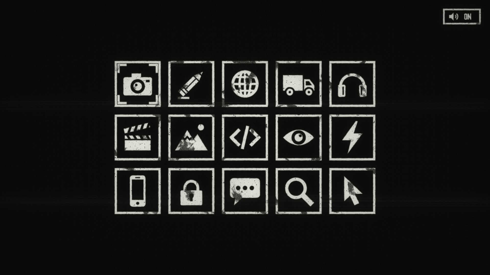
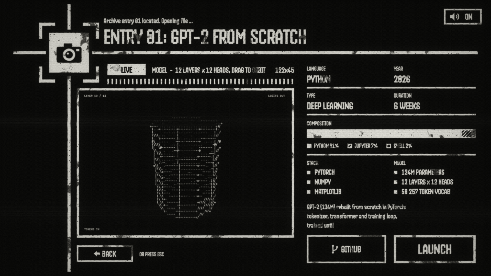
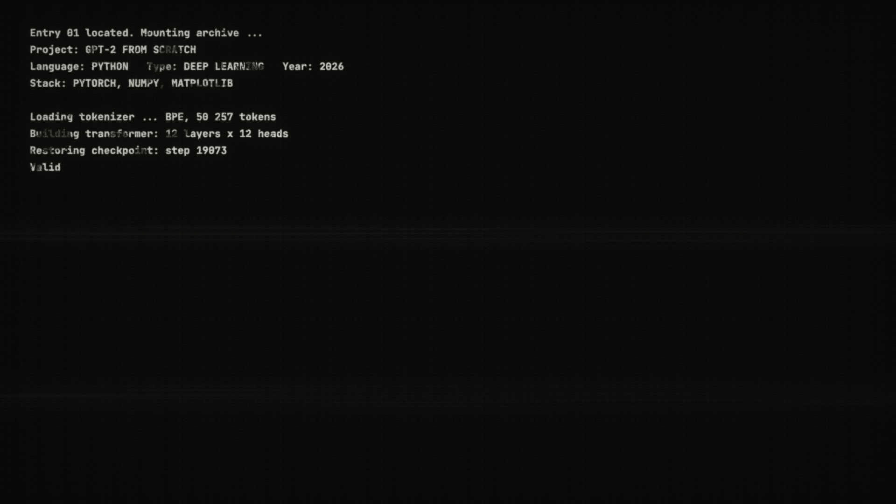

# Portfolio

A portfolio site styled as an old CRT terminal: worn white-on-black interface, phosphor grain, and a frame-timed animation for every step. Projects sit in a 3 × 5 grid of pictograms. Pick one and a crosshair flies to it, the cell flips and moves to the top-left, and a project panel builds itself around a live ASCII view of the project. LAUNCH plays a boot log before the detail page.

Everything is drawn on a single canvas and filtered through a WebGL CRT pass. Every step has its sound: library effects cut, transformed and mixed for the site, timed on the animation frames (see [docs/sound-design.md](docs/sound-design.md)).




## Run it

No build step: it is a static site.

```sh
cd site
python3 -m http.server 8080
```

Then open <http://localhost:8080>.

### Sounds

The sound files are licensed library sounds, so they are not in the repository: without them the site simply runs silent. To build them, put the source library in `sounds-src/` and run (Node and ffmpeg needed):

```sh
node tools/sound/build.mjs            # every cue; or name some: node tools/sound/build.mjs hover lock
```

It writes `site/sounds/` (git-ignored too). The recipes are in `tools/sound/recipes.mjs`, the mix levels at the top of `site/js/sound.js`.

| Input | Action |
|---|---|
| Click a cell, or arrows + Enter | Open a project |
| Drag / scroll on the ASCII screen | Orbit / zoom the 3D view |
| BACK, HOME or Esc | Back to the grid |
| LAUNCH or Enter | Start the launch sequence |
| Sound button (top-right) or M | Mute / unmute: the label decodes again on hover and on each toggle |
| Menu button (top-right) | A console drops down: contact, GitHub, LinkedIn, screen colours, hover style, reboot of the grid. Click an entry, or arrows + Enter (← → change a setting), Esc closes |
| I | Invert the colours (black on paper): the screen flickers into them |

The mute, colour and hover choices are saved in the browser. Browsers block audio until the first click or key press, so the first boot of the grid is silent.

## The flow

1. **Boot**: cells boot one after another in random order, one every 4 frames at 60 fps. Corner brackets blink, the frame closes, then the pictogram fades in. A hovered cell turns negative (or, from the menu, shows corners, the crosshair's lock or a lift) and its entry, type and title type in beside it while the other cells dim.
2. **Selection**: the crosshair fades in, travels to the cell on a fitted cubic-bezier, locks, and the cell tilts, flashes and inverts. The other cells vanish one per frame.
3. **Panel**: the cell and the crosshair move to the top-left, the title types in, then rulers, frames, data blocks and lists light up on a fixed rhythm. The ASCII screen renders the project's design in real time.
4. **Launch**: the button blinks, the panel text is backspaced away, a boot log generated from the project data types out, and the screen cuts to black.
5. **Detail page**: a placeholder for now, with a HOME button.



## Layout

```
site/                  the website
  index.html
  js/app.js            timeline, drawing, input, sound cues
  js/crt.js            WebGL CRT pass: grain, scanlines, wear, bloom, normal / inverted palette
  js/grid.js           grid geometry, cell frames, pictogram drawing
  js/pictos.js         placeholder pictograms (drawn in code)
  js/projects.js       project entries: edit this file to add content
  js/sound.js          sample player: mix levels, variants, voices, ambience, mute
  sounds/              built sounds and their manifest (git-ignored)
prototypes/            the step-by-step design explorations that led to the site
tools/                 Playwright scripts: screenshots, frame sequences, end-to-end and sound tests, audio recording
  sound/               sound build: dsp.mjs (editing), recipes.mjs (one per cue), build.mjs, check.mjs
sounds-src/            the source sound library (git-ignored)
```

### Adding a project

Each grid cell maps to one entry in `site/js/projects.js`, in reading order. An entry sets the title, language, type, year, duration, language composition, stack, a second list, a short description, the ASCII view (`tower`, `network` or `torus`) and a few lines for the launch log. Fields left out fall back to the defaults at the top of the file.

## Tools

```sh
cd tools
npm install
node site-test.mjs                    # end-to-end run of the whole flow (site served on :8080)
node capture.mjs <page> <out> name=query ...   # screenshots of a prototype
node sequence.mjs <page> <out> <query> <from> <to>   # frame-by-frame export
node record-audio.mjs                 # records the site's audio over a scripted run
node sound-test.mjs                   # sounds load and play, hover never stacks, mute, silent without files
node sound/check.mjs <reference>      # the scripted run against a reference clip: spectrograms, level per moment
```

The scripts drive the locally installed Google Chrome through Playwright.

## Status

Content is placeholder: the titles are planned projects and the numbers are made up. Still to come:

- a 3D home made in Blender, a building to scroll down from the developer's desk to the subway, with this portfolio running on the desk's computer (plan: [docs/monde/plan.md](docs/monde/plan.md));
- the project detail page (real images and videos in colour);
- the contact address and the LinkedIn link in the menu (`LINKS` in `site/js/app.js`);
- a mobile layout;
- final pictograms.

## Credits

Fonts: [Handjet](https://fonts.google.com/specimen/Handjet) and [JetBrains Mono](https://fonts.google.com/specimen/JetBrains+Mono), both under the SIL Open Font License, loaded from Google Fonts.
