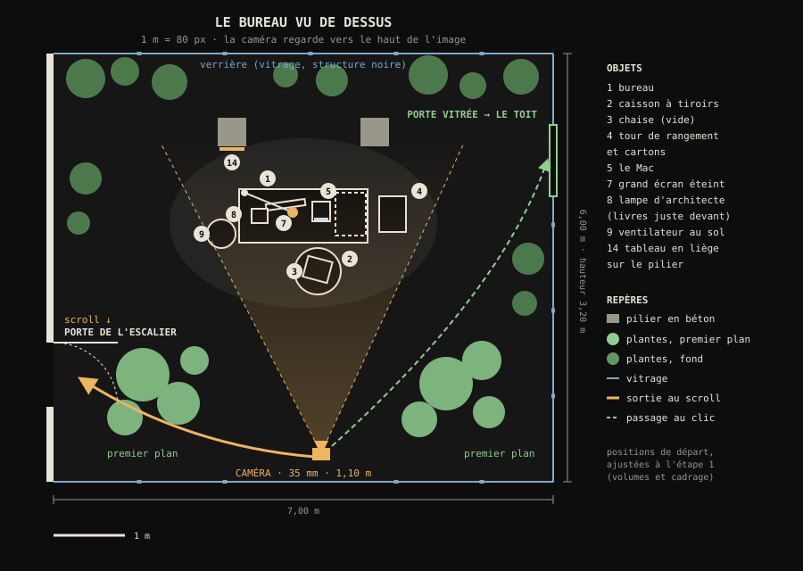
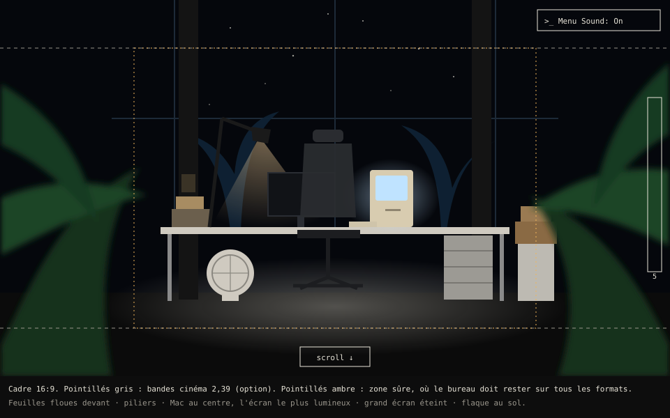

# Le bureau : plan détaillé

Lieu S1 du [plan du monde](plan.md), et premier lieu à construire. Ce document décrit tout ce qu'il faut pour le fabriquer : l'espace, le cadrage, la lumière, chaque objet, les plantes, les matières, ce qui bouge, les interactions, les mouvements de caméra, le son, le budget technique et l'ordre des étapes.

**État (22 octobre 2026)** : l'étape 1 (volumes et cadrage) est faite et attend ta validation : `captures/monde/bureau/etape1-comparaison.png`, fichier `blender/bureau.blend`, script `tools/blender/bureau/00_volumes.py`.

Référence : `reference/monde-3d/bureau.jpeg`. Toutes les dimensions sont en mètres. Les positions sont des valeurs de départ, ajustées à l'étape 1 (volumes et cadrage).

---

## 1. En bref

Une verrière au dernier étage de l'immeuble, la nuit, envahie par les plantes. Au milieu, un bureau éclairé par une lampe d'architecte, une chaise vide, et le Mac allumé, sur lequel tourne le portfolio CRT. On regarde la scène à travers de grandes feuilles floues, comme dans la référence. C'est le premier écran du site.

## 2. La référence, décortiquée

### Ce qu'on voit
- **Le cadre** : très large (format cinéma), sombre, avec un seul îlot de lumière au centre : le bureau.
- **Le premier plan** : de grandes feuilles tropicales, sombres et floues, à gauche et à droite. On regarde à travers elles.
- **L'architecture** : deux piliers sombres de part et d'autre du bureau, un fond noir avec des étoiles, des silhouettes de palmiers bleutées derrière.
- **Le sol** : clair et un peu brillant autour du bureau, avec une flaque de lumière plus large que ce que la lampe seule éclaire.
- **Le bureau** : un long plateau clair sur pieds métalliques.
  - Sous le côté droit, un caisson gris à quatre tiroirs avec étiquettes.
  - À droite, au sol, une tour de rangement blanche et des cartons.
- **Sur le bureau, de gauche à droite** :
  - une lampe d'architecte noire très haute ;
  - des livres et classeurs, avec une petite boîte couverte d'étiquettes ;
  - un grand écran allumé (un dessin) ;
  - un petit ordinateur beige tout-en-un, allumé ;
  - quelques petits objets (un bloc orange, un appareil blanc, une tasse).
- **La chaise** : ergonomique, dossier en maille avec appui-tête, tournée vers le bureau.
- **Au sol, à gauche** : un ventilateur rond blanc.
- **La lumière** : blanche et chaude sur le bureau, bleu nuit partout ailleurs, avec un contour bleuté sur les feuilles.

### Ce qu'on garde
La composition, l'îlot de lumière dans le noir, le premier plan de feuilles, les piliers, le ciel étoilé, le mobilier et sa disposition, la palette de couleurs.

### Ce qu'on change
- **Personne** : la chaise est vide, il n'y a pas le personnage endormi sur le bureau.
- **Le Mac au centre** : il fait entrer dans le site, c'est donc lui l'écran le plus lumineux. Le grand écran de la référence est éteint (choix à valider, § 15).
- **Pas de texte** par-dessus l'image (titre, logos de la référence).
- **Un lieu situé** : la verrière est au dernier étage de notre immeuble, avec une porte vers l'escalier et une porte vitrée vers le toit.
- **Le format** : un écran d'ordinateur (16:9 ou 16:10), plus haut que le format cinéma de la référence (§ 4).

## 3. L'espace : la verrière

- **Dimensions** : 7,00 m de large, 7,10 m de profondeur (de Y −3,6 à Y 3,5), 3,20 m de haut.
- **Repère** (celui de Blender) : origine au centre du sol ; X vers la droite, Y vers le fond (la caméra regarde vers +Y), Z vers le haut.
- **Murs** :
  - **fond, droite, avant et toit** : une verrière, faite d'une structure en acier noir (profilés de 6 cm) et de vitres de 1,20 × 1,20 m, un peu sales. Une vitre est cassée et une liane entre par là ;
  - **gauche** : un mur plein en béton (la cage d'escalier est derrière), avec la porte de l'escalier près de l'avant (Y = −1,0).
- **Piliers** : deux piliers en béton brut de 0,40 × 0,40 m, à X = ±1,0 et Y = 2,4, derrière le bureau. Ils l'encadrent, comme dans la référence.
- **Sol** : béton ciré clair, légèrement brillant.
- **Passages** :
  - la porte de l'escalier (mur de gauche) : la sortie au scroll ;
  - la porte vitrée dans la verrière de droite (Y = 2,0) : le passage vers le toit, au clic.
- **Dehors** : le ciel étoilé, des silhouettes de palmiers et de feuillages contre le ciel.

| Élément | Position (centre) | Taille |
|---|---|---|
| Bureau | X 0, Y 1,22 | 1,80 × 0,75, hauteur 0,74 |
| Le Mac | X 0,42, Y 1,30, sur le bureau | 0,25 × 0,28 × 0,35 |
| Grand écran éteint | X −0,22, Y 1,42, sur le bureau | 0,60 × 0,20 × 0,45 |
| Lampe (pince) | X −0,84, Y 1,58, bord du bureau ; tête vers X −0,62, à 1,15 m de haut | bras de 1,0 m déplié |
| Livres et boîte | X −0,65, Y 1,25 | 0,25 × 0,20 × 0,25 |
| Caisson à tiroirs | X 0,66, Y 1,25, sous le bureau | 0,42 × 0,60 × 0,66 |
| Chaise | X −0,10, Y 0,50, tournée de 10° | 0,65 × 0,65 × 1,25 |
| Ventilateur | X −0,72, Y 0,80, au sol, face à la caméra | diamètre 0,40 |
| Tour de rangement et cartons | X 1,25, Y 1,30, au sol | 0,38 × 0,50 × 0,80, cartons au-dessus |
| Tableau en liège | face avant du pilier gauche | 0,40 × 0,55 |

## 4. Le cadrage

### Le plan principal
- **Caméra** : position X 0,10, Y −3,30, Z 0,95 ; visée vers X 0,05, Y 1,20, Z 0,80 (le centre du bureau). Valeurs fixées à l'étape 1.
- **Objectif** : 40 mm, avec un capteur de 36 mm.
- **Profondeur de champ** : ouverture f/2,8, mise au point sur le Mac (environ 4,7 m). Les feuilles du premier plan, entre 0,7 et 2,5 m, sont floues, comme dans la référence.
- **Composition** :
  - les piliers vers 28 % et 72 % de la largeur ;
  - le bureau entre 25 % et 75 % ;
  - le Mac un peu à droite du centre, l'écran le plus lumineux de l'image ;
  - les feuilles floues sur les deux bords ;
  - le haut et le bas de l'image dans le noir.

### Les formats d'écran
- **Le cadre de référence est en 16:9.**
- **Écran plus haut** (16:10, fréquent sur Mac) : on garde la largeur et on voit un peu plus de sol et de ciel.
- **Écran plus large** (21:9) : on garde la hauteur et on voit plus de feuillage sur les côtés.
- **Dans tous les cas**, le bureau, la chaise et la lampe restent dans la zone sûre (les 60 % du centre).

### Les zones de l'interface
Elles restent libres de tout détail lumineux :
- en haut à droite, les boutons Menu et Son ;
- sur le bord droit, l'indicateur d'étage ;
- en bas au centre, l'indication « scroll ↓ ».

### La scène qui respire
- **Une dérive très lente** de la caméra : 1 cm d'amplitude, sur 8 secondes.
- **Une parallaxe légère** : la caméra tourne de ±1,5° en suivant le curseur, avec un amorti. Les feuilles du premier plan bougent plus que le fond, ce qui donne du relief (choix à valider, § 15).

## 5. La lumière

On reproduit la lumière de la référence : un îlot blanc et chaud au milieu du noir bleuté.

| Source | Type dans Blender | Où | Couleur | Rôle |
|---|---|---|---|---|
| Lampe d'architecte | spot, cône de 70°, bord adouci à 20 %, rayon de 2 cm | dans l'abat-jour, visant le centre du bureau | blanc chaud, 3 500 K | lumière principale, ombres nettes, flaque sur le bureau |
| Lumière douce au-dessus | grande surface lumineuse cachée (2 × 1,5 m) | 2,6 m au-dessus du bureau | blanc neutre, 4 500 K | la flaque claire au sol autour du bureau, et le dessus de la chaise |
| Écran du Mac | surface émissive (le portfolio en direct) | l'écran | bleu-blanc | lueur sur le clavier, la chaise, les objets proches |
| Ciel de nuit | lumière d'environnement | partout | bleu nuit très sombre | les ombres ne sont jamais noires ; contour bleuté des feuilles |
| Contre-jour du fond | surface lumineuse derrière les plantes du fond | derrière la verrière | bleu froid | détache les silhouettes de palmiers, comme dans la référence |
| Voyant | petite émission | façade du Mac | vert | le Mac est allumé |

- **Les réglages de couleur** :
  - rendu AgX en contraste moyen-élevé ;
  - exposition réglée pour que le bureau soit clair et que le reste plonge dans le noir ;
  - un léger halo sur la lampe et les écrans ;
  - une brume très légère dans l'air, qui rend le cône de la lampe visible.
- **Les puissances** se règlent à l'étape 18, en comparant notre rendu côte à côte avec la référence.
- **Dans le site** :
  - la lumière des objets fixes est précalculée ;
  - l'écran du Mac ajoute une petite lumière en temps réel, dont l'intensité suit la luminosité du portfolio : quand la grille s'allume ou passe en mode clair, la lueur sur le clavier et la chaise change avec elle.

## 6. Les objets, un par un

Pour chaque objet : dimensions, forme, matières, usure, niveau de détail, budget de triangles. Les numéros sont ceux de la vue de dessus.

### Mobilier

#### 1. Le bureau
- **Dimensions** : 1,80 × 0,75 m, hauteur 0,74.
- **Forme** : plateau stratifié de 25 mm d'épaisseur, angles arrondis (rayon 1 cm) ; piètement en métal, deux cadres en U et une traverse arrière ; un passe-câbles rond à l'arrière ; patins sous les pieds.
- **Matières** : plateau blanc cassé satiné ; chant gris clair ; métal peint gris, un peu brillant.
- **Usure** : rayures fines, une trace de tasse, le chant un peu jauni à l'endroit des poignets, poussière dans les angles.
- **Niveau** : héros · environ 4 000 triangles.

#### 2. Le caisson à tiroirs
- **Dimensions** : 0,42 × 0,60, hauteur 0,66, sous le côté droit du bureau.
- **Forme** : quatre tiroirs, poignées en creux, porte-étiquettes métalliques avec des étiquettes en papier écrites à la main, roulettes.
- **Matières** : métal peint gris clair, porte-étiquettes chromés, papier.
- **Usure** : un tiroir légèrement entrouvert, une étiquette décollée, des éclats de peinture sur les arêtes.
- **Niveau** : second plan · environ 5 000 triangles.

#### 3. La chaise (vide)
- **Dimensions** : 0,65 × 0,65, hauteur 1,25 avec l'appui-tête.
- **Forme** : chaise ergonomique, dossier et appui-tête en maille tendue sur un cadre en plastique, assise rembourrée, accoudoirs réglables, vérin, piétement à cinq branches, roulettes.
- **Position** : un peu reculée du bureau et tournée de 15°, comme si on venait de se lever.
- **Matières** : maille gris foncé (transparente à contre-jour), plastique noir mat, tissu de l'assise, métal du vérin.
- **Usure** : l'assise un peu creusée, de la poussière sur le piétement.
- **Niveau** : héros · environ 40 000 triangles. La maille est une texture transparente, pas de la géométrie.

#### 4. La tour de rangement et les cartons
- **Dimensions** : tour 0,38 × 0,50, hauteur 0,80 ; deux cartons empilés dessus.
- **Forme** : tour en plastique blanc à quatre tiroirs translucides, dont on devine le contenu ; cartons fermés avec du ruban adhésif, des étiquettes et des inscriptions au feutre.
- **Matières** : plastique blanc, plastique translucide, carton, ruban.
- **Usure** : le carton du dessus affaissé, un coin écrasé.
- **Niveau** : second plan · environ 4 000 triangles.

### Informatique

#### 5. Le Mac
L'objet le plus important du lieu : il fait entrer dans le site.
- **Dimensions** : 0,25 × 0,28, hauteur 0,35.
- **Forme** : un ordinateur tout-en-un beige dans l'esprit des Macintosh compacts des années 1980, sans logo de marque :
  - un écran cathodique de 9 pouces, avec sa vitre bombée et un cadre en retrait ;
  - une fente de lecteur de disquette sous l'écran ;
  - des grilles d'aération sur le dessus et les côtés ;
  - une poignée moulée sur le dessus ;
  - l'interrupteur à l'arrière ;
  - un petit voyant en façade.
- **L'écran** : le portfolio CRT y tourne en direct. Sous la vitre, une légère réflexion de la lampe.
- **Matières** : plastique beige jauni par le temps (plus jaune vers le haut, où la lumière a tapé), vitre de l'écran légèrement réfléchissante.
- **Usure** : jaunissement inégal, de la poussière dans les grilles, un post-it collé sur le côté.
- **Niveau** : héros · environ 15 000 triangles · ses propres textures en haute définition (2 048 px).

#### 6. Le clavier et la souris du Mac
- **Dimensions** : clavier 0,33 × 0,15 ; souris 0,06 × 0,10.
- **Forme** :
  - clavier beige à touches cubiques, lettres imprimées, câble spiralé jusqu'au Mac ;
  - souris à un bouton, câble.
- **Position** : devant le Mac, le clavier un peu de travers.
- **Matières** : plastique beige, touches un peu plus foncées, lettres grises.
- **Usure** : touches usées et brillantes sur les plus utilisées (espace, E, flèches).
- **Niveau** : héros · environ 8 000 triangles.

#### 7. Le grand écran (éteint)
- **Dimensions** : 0,60 × 0,20, hauteur 0,45 avec le pied.
- **Forme** : un écran plat moderne sur pied, éteint ; son verre noir reflète la lampe et le Mac.
- **Rôle** : du réalisme et un contraste entre l'ancien et le nouveau, sans faire concurrence au Mac.
- **Niveau** : second plan · environ 3 000 triangles. Ce choix reste à valider (§ 15).

### Éclairage

#### 8. La lampe d'architecte
- **Dimensions** : bras de 1,0 m déplié ; abat-jour conique de 0,16 m de diamètre.
- **Forme** : pince sur le bord arrière gauche du bureau, deux bras articulés avec ressorts apparents, tête orientable ; le bras monte haut puis redescend au-dessus du centre du bureau, comme dans la référence.
- **Matières** : métal noir mat, ressorts en acier, intérieur de l'abat-jour blanc ; ampoule visible quand on s'approche.
- **Usure** : peinture éraillée aux articulations.
- **Niveau** : héros · environ 8 000 triangles.

### Objets

#### 9. Le ventilateur au sol
- **Dimensions** : diamètre 0,40, hauteur 0,48.
- **Forme** : ventilateur rond blanc, grille circulaire à rayons, hélice à cinq pales, pied court, molette de réglage.
- **Matières** : plastique blanc, grille en métal peint.
- **Animation** : l'hélice tourne (§ 9).
- **Niveau** : second plan · environ 12 000 triangles.

#### 10. Les livres, les classeurs et la boîte
- **Forme** : une pile de livres et de classeurs couchés, une petite boîte en carton couverte d'étiquettes et d'autocollants posée dessus.
- **Matières** : couvertures de couleurs sourdes, tranches lisibles (titres inventés, ou les technologies si on en fait un objet interactif), carton.
- **Niveau** : second plan · environ 3 000 triangles.

#### 11. Les petits objets du bureau
Une tasse avec une trace de café, un pot à crayons, un carnet ouvert, un bloc de post-it orange (le bloc orange de la référence), trois disquettes, une petite enceinte blanche (l'appareil blanc de la référence), une multiprise, des câbles qui courent sur le bureau, une petite plante en pot (voir P8).
- **Niveau** : second plan · environ 15 000 triangles au total.

#### 12. Le téléphone fixe
- **Forme** : téléphone de bureau à touches, combiné posé, cordon spiralé ; beige ou gris, comme le Mac.
- **Rôle** : un emplacement interactif possible (§ 10).
- **Niveau** : second plan · environ 4 000 triangles.

#### 13. Le casque audio
- **Forme** : casque fermé, posé sur la pile de livres ou accroché à la lampe.
- **Rôle** : un emplacement interactif possible (§ 10).
- **Niveau** : second plan · environ 5 000 triangles.

#### 14. Le tableau en liège
- **Dimensions** : 0,40 × 0,55, fixé sur la face avant du pilier gauche.
- **Forme** : liège dans un cadre en bois, avec des papiers, des photos, des tickets et des post-it épinglés.
- **Rôle** : un emplacement interactif possible (§ 10).
- **Niveau** : second plan · environ 2 000 triangles.

#### 15. Les câbles et la multiprise au sol
Les câbles descendent du passe-câbles jusqu'à une multiprise au sol, puis vont jusqu'au mur. Un câble va au ventilateur.
- **Niveau** : décor · environ 3 000 triangles.

### Architecture

#### 16. Le sol
Dalle de béton ciré clair, joints de dilatation tous les 2 m, légère brillance (on voit le reflet flou du bureau), fissures fines avec un peu de mousse dans les coins sombres.
- **Texture** : béton de Poly Haven comme base, retravaillé.

#### 17. Les piliers
Béton brut de banche (traces de coffrage), arêtes un peu éclatées, coulures, une liane qui grimpe sur le pilier droit.

#### 18. La verrière
Structure en profilés d'acier noir (montants, traverses, chéneau), vitres de 1,20 × 1,20 m avec poussière et traces de pluie, une vitre cassée (la liane entre par là), feuilles mortes posées sur le toit vitré.
- **Niveau** : décor · la structure est un module répété, très peu coûteux.

#### 19. Le mur de gauche et la porte de l'escalier
Mur en béton peint, plinthe, interrupteur, prise ; porte métallique peinte avec poignée, plaque « 5 » et un petit hublot. Elle est fermée, et s'ouvre pendant la sortie au scroll.

#### 20. La porte vitrée vers le toit
Une porte dans la verrière de droite, même structure noire, poignée en métal, entrouverte, avec une plante qui pousse devant.

### Dehors

#### 21. Le ciel et les silhouettes
Un ciel nocturne très sombre, des étoiles (dont quelques-unes qui scintillent), des silhouettes de palmiers et de grands feuillages contre le ciel, éclairées par un contre-jour bleu froid.
- **Fabrication** : un dôme de ciel et des plans découpés pour les silhouettes.

## 7. Les plantes

Les plantes construisent l'ambiance autant que le mobilier. Elles forment la première bibliothèque commune, réutilisée dans les autres lieux.

| # | Plante | Où | Rôle dans l'image | Fabrication |
|---|---|---|---|---|
| P1 | Monstera | premier plan gauche | grandes feuilles découpées, floues, qui encadrent | feuilles en géométrie (vues de près) |
| P2 | Strelitzia (oiseau de paradis) | premier plan gauche, plus haut | longues feuilles verticales, comme dans la référence | feuilles en géométrie |
| P3 | Alocasia | premier plan droit | grandes feuilles en cœur, nervures claires | feuilles en géométrie |
| P4 | Philodendron | droite, à mi-distance | masse de feuillage | feuilles en géométrie simplifiée |
| P5 | Palmiers | au fond, dedans et dehors | silhouettes bleutées contre le ciel | plans découpés avec transparence |
| P6 | Fougères | au fond, au pied de la verrière | texture fine | plans découpés |
| P7 | Pothos | pend de la structure au-dessus du bureau, entre par la vitre cassée | la nature qui reprend la pièce | liane suivant une courbe, feuilles réparties |
| P8 | Petite plante | dans un pot sur le bureau | vie, échelle | géométrie |

- **Feuilles** : textures de couleur, de transparence et de relief faites dans Blender ; les feuilles laissent passer un peu de lumière quand elles sont à contre-jour, ce qui donne leur lueur verte.
- **Variété** : chaque espèce a 3 ou 4 variantes de feuilles ; tailles et rotations aléatoires, quelques feuilles abîmées ou jaunies.
- **Mouvement** : un léger balancement dans le site (§ 9).

## 8. Matières et textures

| Matière | Où | Base | Points clés |
|---|---|---|---|
| Stratifié blanc cassé | plateau du bureau | procédurale | satiné, rayures fines |
| Métal peint gris | piètement, caisson | procédurale | éclats sur les arêtes |
| Plastique beige jauni | Mac, clavier, souris, téléphone | procédurale | jaunissement inégal, grain fin |
| Plastique noir mat | chaise, lampe, écran | procédurale | poussière dans les creux |
| Maille | dossier de la chaise | texture faite dans Blender | transparente à contre-jour |
| Verre d'écran | Mac (bombé), grand écran | procédurale | reflets, poussière |
| Béton ciré | sol | Poly Haven, retravaillé | légère brillance, joints |
| Béton brut | piliers, mur | Poly Haven, retravaillé | traces de coffrage, coulures |
| Acier noir | verrière, lampe | procédurale | peinture usée |
| Verre sale | verrière | procédurale | poussière, traces de pluie |
| Carton | cartons, boîte | Poly Haven ou procédurale | ruban, étiquettes |
| Papier | étiquettes, post-it, papiers du tableau | graphismes faits par nous | écriture manuscrite inventée |
| Liège | tableau | procédurale | |
| Feuilles | plantes | faites dans Blender | transparence, translucidité |

Toutes les matières sont précalculées en textures pour le site. Les objets les plus visibles (Mac, clavier, lampe, chaise) gardent leurs propres textures ; le reste partage de grandes textures communes.

## 9. Ce qui bouge

| Élément | Mouvement | Réglage de départ |
|---|---|---|
| Hélice du ventilateur | rotation | 4 tours par seconde, avec un léger flou de mouvement simulé |
| Écran du Mac | le portfolio en direct, son scintillement CRT | celui du portfolio |
| Feuilles | balancement doux, comme un courant d'air (celui du ventilateur, plus fort près de lui) | 2 à 4 mm, une période de 3 à 6 s, désynchronisé |
| Poussière | particules dans le cône de la lampe | environ 200, très lentes |
| Étoiles | quelques-unes scintillent | une sur dix |
| Caméra | dérive lente et parallaxe au curseur | § 4 |

## 10. Les interactions

### Fixes
| Objet | Action |
|---|---|
| Le Mac | entrer dans le portfolio CRT (§ 11) |
| La porte vitrée | aller sur le toit (B1) |
| Scroll ↓ | sortir par la porte de l'escalier (§ 11) |

### Emplacements possibles
Le contenu arrivera au fur et à mesure : ces objets sont prêts à devenir cliquables, sans rôle figé.
- le tableau en liège ;
- les livres ;
- le téléphone ;
- le casque ;
- le carnet ;
- les cartons.

Tant qu'un objet n'a pas de contenu, il reste un simple décor.

### Au survol et au clic
- **Survol** : les crochets du viseur se posent autour de l'objet (le verrouillage du portfolio CRT), et son nom se tape à côté. On entend le tic doux des cases. Le curseur devient une main.
- **Clic sur un emplacement** : la caméra s'approche de l'objet (§ 11), et un panneau s'ouvre du côté libre de l'image, avec son texte qui se tape. Échap, un clic à côté ou un scroll referment le panneau.
- **Zones de clic** : des volumes invisibles et simplifiés nommés `hit.<objet>`, un peu plus grands que l'objet, pour qu'il soit facile à viser.

## 11. Les mouvements de caméra

Tous les mouvements sont tracés dans Blender. Chaque point de vue est un repère nommé `cam.<nom>`.

### L'arrivée
1. **Après l'écran « click to enter »**, la caméra part de derrière les feuilles du premier plan, l'image entièrement floue et verte (X 0,6, Y −3,0, Z 1,3).
2. **Elle glisse entre les feuilles** jusqu'au plan principal, en 3,5 s, en ralentissant à la fin.
3. **Le son** du lieu monte pendant ce temps. L'écran du Mac brille déjà.

### Les gros plans
- **Durée** : 0,8 s vers le repère de l'objet, en accélérant puis en ralentissant.
- **Pendant le gros plan** : mise au point sur l'objet, et le fond s'assombrit un peu.
- **Retour** : le même mouvement, à l'envers.

### Entrer dans le Mac
1. **Clic sur le Mac** : en 0,9 s, la caméra vient face à l'écran (`cam.mac`, environ 0,55 m devant), et l'écran remplit 40 % de l'image.
2. **Sans s'arrêter**, elle avance jusqu'à ce que l'écran remplisse toute la fenêtre (1,2 s). La courbure et les reflets de la vitre disparaissent à la fin.
3. **Le portfolio CRT prend le relais** en plein écran, à l'image près, et la grille s'allume avec son son.
4. **Pour revenir**, c'est le même mouvement, à l'envers : l'image rétrécit dans l'écran, et la caméra recule jusqu'au plan principal.

### Vers le toit (clic sur la porte vitrée)
La caméra pivote vers la droite et avance jusqu'à la porte vitrée. En la franchissant, l'image s'illumine du soleil chaud du toit (sa lumière de référence), puis le toit apparaît.

### La sortie vers l'escalier (scroll ↓)
| Repère | Moment | Position de la caméra |
|---|---|---|
| `cam.stop.desk` | 0 % | le plan principal |
| `cam.exit.1` | 30 % | recule vers X −1,6, Y −1,6 en pivotant vers la gauche (−60°) ; le bureau sort du cadre par la droite |
| `cam.exit.2` | 65 % | face à la porte de l'escalier, à 1,2 m ; la porte s'ouvre vers l'intérieur |
| `cam.exit.3` | 100 % | passe la porte, dans le noir : on change de lieu |

- **Durée** : environ 2,4 s à vitesse normale de scroll.
- **Remonter** : le trajet se joue à l'envers.

## 12. Le son

| Couche | Description |
|---|---|
| Ventilateur | souffle régulier, avec le léger cliquetis de l'hélice |
| Écran cathodique | sifflement très léger, presque inaudible, plus présent en gros plan sur le Mac |
| Dehors | insectes de nuit étouffés par la verrière, ville lointaine |
| Feuilles | bruissement léger quand elles bougent |
| Interface | tic doux au survol, clic, son de l'écran qui s'allume quand on entre dans le Mac |

- **Mixage** : le son se rapproche du Mac pendant le gros plan ; il est coupé par le bouton Son et le casque.
- **Sources** : la chaîne de montage sonore existante, avec de nouvelles sources à trouver (ventilateur, insectes, sifflement).

## 13. Budget technique

| Poste | Budget |
|---|---|
| Mobilier et objets (1 à 15) | environ 130 000 triangles |
| Architecture (16 à 20) | environ 20 000 triangles |
| Plantes | environ 120 000 triangles (premier plan en géométrie, fond en plans découpés) |
| Ciel | presque rien |
| **Total** | **environ 270 000 triangles** (limite du plan du monde : 400 000) |
| Appels de dessin | moins de 80, en fusionnant les objets fixes |
| Textures | deux grandes textures de lumière précalculée (4 096 px), des textures propres pour le Mac, le clavier, la lampe et la chaise (2 048 px), les feuilles |
| Poids du lieu | 15 Mo au plus, compressé |

## 14. Ordre de fabrication

Une étape à la fois. Chaque étape se termine par des captures depuis le plan principal et en gros plan, ta validation (avec 2 ou 3 variantes quand il y a un vrai choix), puis un commit.

- [ ] 1. **Volumes et cadrage** : la pièce, les piliers, le bureau, la chaise, le Mac, la lampe et les plantes du premier plan en formes simples ; la caméra. On compare côte à côte avec la référence et on valide le cadrage.
- [ ] 2. **Le bureau** (1)
- [ ] 3. **Le caisson à tiroirs** (2)
- [ ] 4. **Le Mac** (5)
- [ ] 5. **Le clavier et la souris** (6)
- [ ] 6. **La lampe d'architecte** (8)
- [ ] 7. **La chaise** (3)
- [ ] 8. **Le ventilateur** (9)
- [ ] 9. **Le grand écran** (7), selon le choix du § 15
- [ ] 10. **Les livres, les classeurs et la boîte** (10)
- [ ] 11. **Les petits objets du bureau** (11)
- [ ] 12. **Le téléphone et le casque** (12, 13)
- [ ] 13. **La tour de rangement et les cartons** (4)
- [ ] 14. **Le tableau en liège** (14)
- [ ] 15. **L'architecture** : sol, piliers, verrière, mur, portes, câbles (15 à 20)
- [ ] 16. **Les plantes**, une espèce à la fois (P1 à P8)
- [ ] 17. **Le ciel et les silhouettes** (21)
- [ ] 18. **La lumière et le rendu** : réglages jusqu'à retrouver la référence, comparaison côte à côte
- [ ] 19. **Précalcul, export et intégration au site** : le bureau s'affiche dans le navigateur
- [ ] 20. **Interactions et caméra** : survol, gros plans, entrée dans le Mac, porte vitrée, sortie vers l'escalier
- [ ] 21. **Son et vie** : ambiance, ventilateur, feuilles, poussière
- [ ] 22. **Finitions** : fluidité, poids, détails

Avant l'étape 1, la phase « Fondations » du plan du monde doit être faite : Blender connecté, Git LFS, et un prototype technique qui fait passer un objet de Blender jusqu'au site.

## 15. Choix à valider

| Choix                          | Options                                                                           | Recommandation                                                                                            |
| ------------------------------ | --------------------------------------------------------------------------------- | --------------------------------------------------------------------------------------------------------- |
| Le lieu                        | une **verrière** au dernier étage, ou une pièce classique avec une grande fenêtre | la verrière : fidèle à la référence (structure en cage, étoiles visibles), et c'est bien le dernier étage |
| Le grand écran de la référence | **éteint** sur le côté, allumé, ou supprimé                                       | éteint : réaliste, sans faire concurrence au Mac                                                          |
| Le format                      | **plein écran** 16:9, ou bandes noires de cinéma 2,39                             | plein écran, avec la composition adaptée (§ 4)                                                            |
| La parallaxe au curseur        | **oui** (±1,5°), ou caméra fixe                                                   | oui : la scène vit sans qu'on se déplace                                                                  |
| Une trace de vie sur la chaise | une veste ou un sweat posé dessus, ou **rien**                                    | à ton goût : la chaise reste vide dans les deux cas                                                       |
