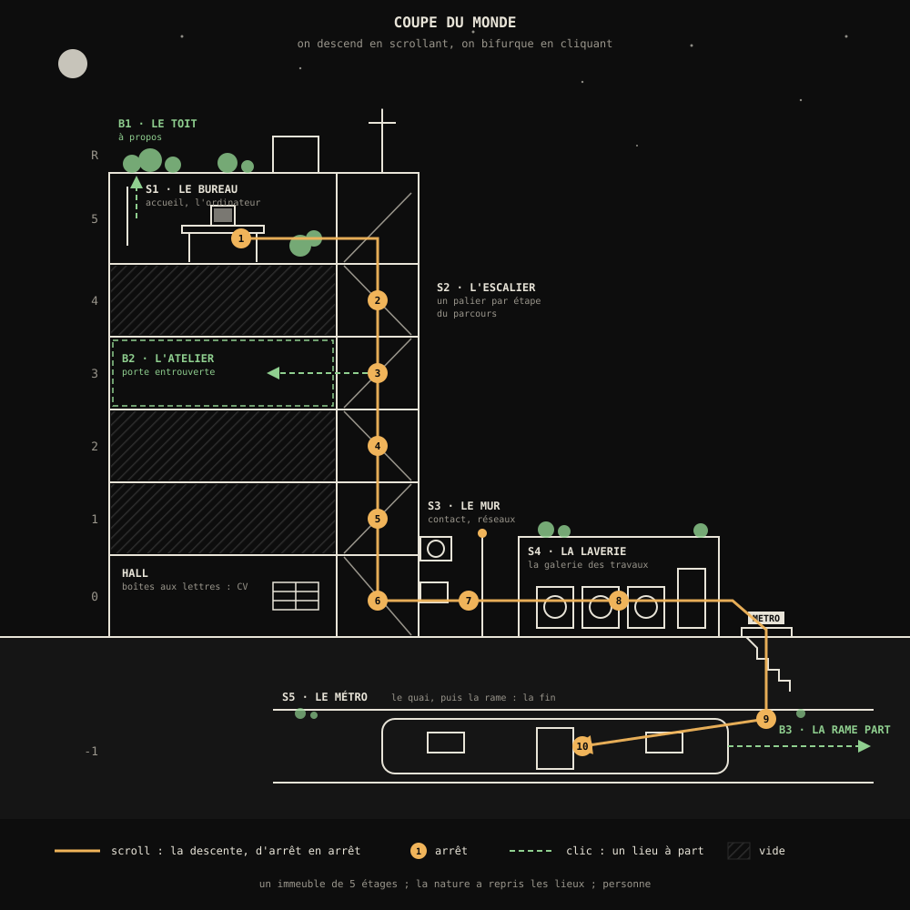

# Le monde 3D : plan complet

Le plan de l'écran d'accueil en 3D et de tout le monde autour. Il sert de feuille de route : chaque lieu, chaque modèle, chaque interaction y est listé, dans l'ordre où on les fabriquera. Rédigé le 22 octobre 2026, avant tout modèle. Chaque lieu a ensuite son plan détaillé ; le premier est celui du [bureau](bureau.md).

Les images de référence sont dans `reference/monde-3d/` (dossier local, non versionné : ce sont les œuvres d'autres artistes).

---

## 1. L'idée en bref

Un immeuble de cinq étages. Il est vide : personne, juste des traces de vie, et la nature qui a repris sa place. Au dernier étage, un bureau de développeur, une lampe allumée, un vieil ordinateur (le Mac) qui tourne.

- **On arrive dans le bureau.** C'est l'accueil.
- **On scrolle pour descendre** : la cage d'escalier, la cour arrière, la laverie du rez-de-chaussée, puis le métro sous terre.
- **On clique dans chaque lieu** pour lire des informations ou pour aller dans un lieu à part (le toit, un atelier, la rame qui part).
- **L'écran de l'ordinateur fait entrer dans le portfolio CRT** déjà construit (la grille des projets). Au LAUNCH d'un projet, la réalité se brise et le projet est présenté dans un style futuriste.

Le mélange recherché : un monde 3D réaliste, une interface rétro par-dessus (la typographie, les crochets et le texte qui se tape du portfolio CRT) et une touche de science-fiction quand la réalité se brise.

## 2. Ce qui est décidé

| Sujet | Décision |
|---|---|
| Rendu | 3D réaliste, dans le style des références du bureau et du métro |
| Navigation | scroll pour descendre, clic pour interagir ; pas de déplacement libre |
| Organisation | un immeuble vertical : bureau en haut, métro tout en bas |
| Personnages | aucun : les lieux sont vides, la chaise du bureau aussi |
| Fabrication | tout est fait par nous, de A à Z, sans budget. Claude modélise en pilotant Blender, un modèle à la fois, pièce par pièce |
| Ressources | les textures et ciels gratuits du domaine public (Poly Haven) sont permis quand ils font gagner du temps |
| Lumière | chaque lieu garde la lumière de sa référence ; pas de jour et nuit, pas de changement d'éclairage. Le mode clair / sombre ne concerne que l'écran du Mac |
| Contenu | rien de figé : projets, réalisations et textes arrivent au fur et à mesure. Les objets cliquables sont des emplacements |
| Fichiers Blender | dans le dépôt, suivis par Git LFS |
| Nom affiché | plus tard |
| Mise en ligne | plus tard, quand ce sera utile, sans attendre que tout soit fini |
| Téléphone | pas de version 3D : une page simple qui invite à revenir sur ordinateur |
| Méthode | pas de précipitation : ce plan d'abord, puis le plan détaillé de chaque lieu, puis une étape à la fois, avec validation |

## 3. Le monde : un immeuble, de haut en bas

La descente compte **10 arrêts**. Le scroll fait passer de l'un à l'autre.

| Arrêt | Étage | Lieu | Ce qu'on y fait |
|---|---|---|---|
| 1 | 5 | **S1 · Le bureau** | l'accueil ; l'ordinateur fait entrer dans les projets |
| 2 | 4 | **S2 · L'escalier**, palier | étape 1 du parcours |
| 3 | 3 | palier | étape 2 du parcours ; une porte entrouverte mène à l'atelier |
| 4 | 2 | palier | étape 3 du parcours |
| 5 | 1 | palier | étape 4 du parcours |
| 6 | 0 | le hall | les boîtes aux lettres : le CV |
| 7 | 0 | **S3 · Le mur** (la cour arrière) | contact et réseaux |
| 8 | 0 | **S4 · La laverie** | la galerie des autres travaux |
| 9 | -1 | **S5 · Le métro**, le quai | la rame arrive |
| 10 | -1 | la rame | la fin : CV, contact, crédits |

On rejoint trois lieux à part par un clic :

| Lieu | Depuis | Contenu |
|---|---|---|
| **B1 · Le toit** | la fenêtre du bureau | à propos : qui je suis, ce qui m'inspire |
| **B2 · L'atelier** | la porte entrouverte du 3e | les travaux de 3D et de design (selon ce que tu veux montrer) |
| **B3 · La rame part** | les portes de la rame | le voyage final, puis le retour en haut |

Le nombre de paliers suit le nombre d'étapes du parcours. L'escalier est fait d'un module d'étage répété : ajouter un étage ne coûte presque rien.

## 4. Comment on s'y déplace

### Le scroll

- **Une descente continue, aimantée aux arrêts.** La molette ou le pavé tactile fait avancer la caméra sur son trajet. Quand on lâche, elle se pose sur l'arrêt le plus proche. Un trajet dure 1,5 à 3 secondes à vitesse normale.
- **Des trajets tracés dans Blender.** Une seule caméra, animée sur toute la descente, avec un repère à chaque arrêt. Le scroll fait défiler son animation.
- **Remonter est possible** : on scrolle vers le haut, le trajet se joue à l'envers.
- **Les flèches ↑ ↓, Page précédente / suivante et Espace** font la même chose au clavier.

### Le clic

- **Survol** d'un objet cliquable : les crochets du viseur se posent autour de lui et son nom se tape à côté. C'est le survol « étiquette » et le verrouillage du portfolio CRT. On entend le tic doux des cases.
- **Clic sur un objet d'information** : la caméra s'approche de l'objet, et un panneau s'ouvre à côté, avec son texte qui se tape. Échap, un clic à côté ou un scroll referment le panneau, et la caméra revient.
- **Clic sur un passage** (fenêtre, porte entrouverte, portes de la rame) : la caméra quitte la descente pour un lieu à part. Un bouton « retour » ou un scroll ramènent au point de départ.

### Toujours à l'écran

- **En haut à droite** : les boutons Menu et Son du portfolio CRT, dans le même style. Le menu reprend la console : contact, github, linkedin, la version simple, le son.
- **Sur le bord droit, un indicateur d'étage** comme dans un ascenseur : R, 5, 4, 3, 2, 1, 0, -1. L'étage en cours est mis en avant et change pendant la descente. Un clic sur un étage y emmène en accéléré.
- **Au premier arrêt seulement**, une indication « scroll ↓ ».
- **Un lien « version simple »** (dans le menu) mène à la page sans 3D, pour un recruteur pressé.

## 5. Direction artistique

### Le rendu
3D réaliste, comme les rendus du bureau et du métro : objets aux vraies dimensions, arêtes adoucies, usure, poussière, petits défauts. Les deux références peintes, le toit et la ruelle aux climatiseurs, servent pour l'ambiance et la lumière, pas pour le style.

### La lumière : celle des références
Chaque lieu garde la lumière de son image de référence. Il n'y a ni jour et nuit, ni changement d'éclairage.

| Lieu | Lumière |
|---|---|
| Bureau | de nuit : la lampe d'architecte et les écrans dans le noir, une lueur bleue sur les plantes, des étoiles |
| Escalier | pas encore de référence : à choisir dans son plan détaillé |
| Mur | soleil rasant de fin de journée, chaud, ombres franches, poussière qui flotte dans la lumière |
| Laverie | tubes fluorescents, lumière un peu verdâtre, lueur du distributeur |
| Métro | intérieur de rame chaud et doux |
| Toit | soleil chaud de fin de journée qui traverse la végétation |

Les lieux ne sont donc pas à la même heure : le bureau est de nuit, le mur et le toit au soleil couchant. Chaque lieu est comme un souvenir à part, et les passages sombres entre les lieux rendent ces changements naturels.

### La nature
Elle est partout et relie les lieux : plantes en pot devenues trop grandes au bureau, lierre qui entre par la fenêtre cassée de l'escalier, glycine sur le balcon du mur, plante qui pousse dans la laverie, mousse et racines qui percent le carrelage du métro. On construit une bibliothèque de plantes une fois (§ 12), puis on la réutilise partout.

### Le vide
Personne, mais des traces : une tasse, une veste sur la chaise, des papiers, une machine qui tourne encore. Le visiteur doit avoir l'impression d'arriver juste après que quelqu'un est parti.

### L'interface par-dessus
Tout ce qui n'est pas la 3D reprend le langage du portfolio CRT :
- JetBrains Mono pour les boutons et les étiquettes, Handjet pour les titres ;
- texte qui se tape ou se décode ;
- crochets du viseur ;
- blanc chaud sur noir.

Les panneaux d'information sont des cadres sobres semi-transparents, comme des écrans de contrôle posés sur le monde.

### Les graphismes du monde
Affiches, enseignes, étiquettes, plaques, autocollants : tout est dessiné par nous, dans un univers inventé cohérent (marques, horaires, numéros d'étage). Ton nom peut apparaître sur l'enseigne de la laverie, la plaque de la station de métro, la boîte aux lettres.

## 6. Les lieux, un par un

Chaque fiche liste les modèles **dans l'ordre de fabrication** et sert de liste de suivi. Niveau de détail :
- **héros** : vu de près ou cliquable, très détaillé ;
- **second plan** : détaillé, mais vu de plus loin ;
- **décor** : formes simples.

### S1 · Le bureau (5e étage) : l'accueil

Tout est dans son **plan détaillé : [bureau.md](bureau.md)**. En résumé :
- **Rôle** : le premier écran du site ; le Mac fait entrer dans les projets.
- **Le lieu** : une verrière au dernier étage, envahie par les plantes, la nuit, avec la lumière de la référence.
- **Composition** : celle de la référence, vue à travers les feuilles du premier plan.
- **Les objets** : 21 éléments (mobilier, objets, architecture, ciel), plus 8 plantes.
- **Sortie (scroll ↓)** : par la porte de l'escalier, dans le mur de gauche.

### S2 · L'escalier (du 4e au rez-de-chaussée) : le parcours

- **Rôle** : chaque palier est une étape de ton parcours (formation, expérience, projet marquant). Le numéro d'étage peint au pochoir sur le mur est remplacé par l'année : en descendant, on remonte le temps.
- **Référence** : pas d'image pour l'instant. Une cage d'escalier en béton, avec un vide central et des volées qui tournent autour.
- **Plan principal (à chaque palier)** : la caméra est dans le vide central et regarde le palier un peu en plongée : la porte, l'année au pochoir, la lumière. Focale 28 mm.
- **Entre deux paliers** : la caméra descend dans le vide et fait un demi-tour par étage. On obtient une spirale vers le bas, un très beau mouvement vertical.
- **Lumière** : à choisir avec une référence dans son plan détaillé. Idée de départ : un tube fluorescent par palier (l'un grillé, l'un qui clignote), la lumière du jour par les fenêtres de palier, le panneau vert « sortie » au rez-de-chaussée.

**Modèles**

- [ ] 1. Module d'étage : deux volées de marches, palier, rampe et garde-corps métalliques (héros, répété)
- [ ] 2. Porte d'appartement avec numéro et paillasson (héros, cliquable : l'étape du parcours)
- [ ] 3. Année peinte au pochoir sur le mur (graphisme)
- [ ] 4. Fenêtre de palier, une vitre cassée (second plan)
- [ ] 5. Lierre qui entre par la fenêtre et court sur les murs (bibliothèque)
- [ ] 6. Tube fluorescent et son boîtier (second plan)
- [ ] 7. Extincteur, armoire électrique, compteur (second plan)
- [ ] 8. Porte entrouverte du 3e, avec un rai de lumière (héros, passage vers l'atelier)
- [ ] 9. Hall : boîtes aux lettres, panneau d'affichage avec avis aux résidents, vélo abandonné, carrelage (second plan)
- [ ] 10. Panneau « sortie » lumineux, porte de service (second plan)
- [ ] 11. Objets abandonnés : plante en pot, sac, chaise (décor)

**Points cliquables**

| Objet | Action |
|---|---|
| Porte de chaque palier | l'étape du parcours : année, lieu, rôle, ce que j'y ai fait |
| Porte entrouverte du 3e | aller dans l'atelier (B2) |
| Ta boîte aux lettres (hall) | télécharger le CV |
| Panneau d'affichage (hall) | actualités : ce sur quoi je travaille en ce moment |

- **Vie** : tube qui clignote, lierre qui bouge au vent de la fenêtre cassée, poussière.
- **Son** : grande réverbération du béton, bourdonnement des tubes, gouttes, vent par la vitre cassée.
- **Sortie (scroll ↓)** : la porte de service s'ouvre ; dans un passage sombre, on sort dans la cour arrière.

### S3 · Le mur (la cour arrière) : contact et réseaux

- **Rôle** : te joindre. Le mur est couvert de ce qu'on trouve sur un mur de ville : affiches, autocollants, compteurs, câbles.
- **Référence** : `mur.jpeg` (climatiseurs, compteurs, balcon fleuri, escabeau), avec sa lumière : un soleil rasant de fin de journée.
- **Plan principal** : vue de face sur le mur, caméra à 1,6 m, focale 50 mm. Le soleil, bas sur la gauche, dessine l'ombre du garde-corps du balcon sur le mur et le sol.
- **Lumière** : soleil rasant (chaud, dur), ciel en lumière d'appoint, poussière dans le faisceau.

**Modèles**

- [ ] 1. Façade : bardage métallique ondulé et enduit, gouttière, tuyaux (héros)
- [ ] 2. Climatiseurs extérieurs, un à hélice visible qui tourne (héros, cliquables : autocollants)
- [ ] 3. Compteurs électriques, boîtiers, câbles qui pendent (second plan)
- [ ] 4. Balcon : garde-corps, jardinière, glycine qui retombe (second plan, bibliothèque)
- [ ] 5. Escabeau en bois sous un climatiseur (second plan)
- [ ] 6. Affiche à languettes « contact » (héros, cliquable)
- [ ] 7. Autocollants et tag sur les climatiseurs et le mur (graphisme, cliquables)
- [ ] 8. Lampe murale éteinte (décor)
- [ ] 9. Sol : asphalte, flaques, herbes folles dans les fissures (décor)
- [ ] 10. Fils électriques au-dessus, poubelles, caisses (décor)

**Points cliquables**

| Objet | Action |
|---|---|
| Affiche à languettes | une languette se détache et l'e-mail est copié |
| Autocollant « github » | ouvrir GitHub |
| Autocollant « linkedin » | ouvrir LinkedIn |
| Boîte aux lettres murale (option) | écrire un message (lien mailto) |

- **Vie** : hélice du climatiseur, poussière qui flotte dans le soleil, reflets dans les flaques, feuilles de la glycine.
- **Son** : ronronnement des climatiseurs, circulation lointaine, oiseaux, insectes.
- **Sortie (scroll ↓)** : travelling latéral le long du mur jusqu'au coin de la rue, où brille la vitrine de la laverie. On entre par la porte vitrée.

### S4 · La laverie : la galerie des travaux

- **Rôle** : montrer les autres travaux (vidéo, 3D, design, photo, selon ce que tu choisis). Chaque machine est un travail : son hublot passe un aperçu en boucle.
- **Référence** : `laverie.jpeg` (laverie, machines frontales, chaise en plastique, paniers à roulettes, distributeur).
- **Plan principal** : vue de face sur la rangée de machines, caméra basse à 1,2 m, focale 28 mm, comme la référence.
- **Lumière** : celle de la référence : tubes fluorescents (un qui clignote), lueur du distributeur de boissons, lueur des hublots.

**Modèles**

- [ ] 1. Lave-linge frontal, avec un hublot qui sert d'écran (héros, cliquable, répété avec des variations)
- [ ] 2. Sèche-linge empilés (second plan)
- [ ] 3. Distributeur de boissons lumineux (héros, cliquable)
- [ ] 4. Monnayeur et lessive (second plan)
- [ ] 5. Télévision dans un coin en hauteur (second plan, cliquable : bande démo)
- [ ] 6. Chaise en plastique, table pliante, banc (second plan)
- [ ] 7. Paniers à linge sur roulettes (second plan)
- [ ] 8. Affiches et règlement intérieur (graphisme, cliquables : travaux de design)
- [ ] 9. Pièce : carrelage, faux plafond avec dalles, tubes, vitrine et porte (décor)
- [ ] 10. Plante qui passe par une dalle du plafond, plante en pot (bibliothèque)

**Points cliquables**

| Objet | Action |
|---|---|
| Chaque machine | la caméra s'approche du hublot ; le travail en grand, avec son texte |
| Télévision | bande démo |
| Distributeur | une canette tombe : un travail au hasard |
| Affiches | travaux de design |

- **Vie** : tambours qui tournent, tube qui clignote, distributeur qui ronronne, linge dans les paniers.
- **Son** : tambours, bourdonnement des tubes, compresseur du distributeur, pièce qui tombe au clic.
- **Sortie (scroll ↓)** : on ressort ; juste à côté, l'entrée du métro et son enseigne. La caméra descend l'escalier, dans le noir, jusqu'au quai.

### S5 · Le métro (sous terre) : la fin

- **Rôle** : la fin du voyage. Sur le quai, la rame arrive ; à l'intérieur, les affiches résument : CV, contact, crédits. Ton nom est celui de la station.
- **Référence** : `metro.gif` (intérieur de rame, vue de face et symétrique sur les portes, affiches, banquettes rouges, étui de guitare).
- **Plans** :
  - le quai : vue en enfilade, focale 24 mm, le tunnel au fond ;
  - la rame : vue de face et symétrique sur les portes d'en face, focale 35 mm, comme la référence.
- **Lumière** : quai en blanc neutre avec quelques néons morts, rame chaude, phares de la rame dans le tunnel, lumière qui tombe des grilles d'aération (un rayon dans la poussière).

**Modèles**

- [ ] 1. Quai : bord avec bande podotactile, carrelage, piliers, plafond (héros)
- [ ] 2. Voies et entrée du tunnel (second plan)
- [ ] 3. Plaque de station avec ton nom, plan du réseau, horloge (graphisme)
- [ ] 4. Bancs, poubelle, distributeur de tickets (second plan)
- [ ] 5. Rame, extérieur : face avant, phares, portes (héros)
- [ ] 6. Rame, intérieur : portes, banquettes rouges, barres, poignées, éclairage (héros)
- [ ] 7. Affiches dans la rame (graphisme, cliquables)
- [ ] 8. Objets laissés : étui de guitare, tabouret, sac (second plan)
- [ ] 9. Graffitis et morpion gravé sur les portes (graphisme)
- [ ] 10. Mousse, racines qui percent le carrelage, flaque (bibliothèque)

**Points cliquables**

| Objet | Action |
|---|---|
| Affiche « CV » | télécharger le CV |
| Affiche « contact » | contact |
| Affiche « crédits » | comment le site a été fait (Blender, three.js, sons) |
| Portes de la rame | partir (B3) |

- **Vie** : arrivée de la rame (freinage, portes qui s'ouvrent), néon qui clignote, poussière dans le rayon de lumière.
- **Son** : ambiance de station, rame qui arrive (grondement, crissement), signal sonore des portes, ronronnement de la rame à l'arrêt.

### B1 · Le toit : à propos

- **Rôle** : un moment calme pour la présentation longue : qui tu es, ce qui t'inspire, tes centres d'intérêt.
- **Référence** : `toit.jpeg` (toit envahi par la végétation, pigeons), sans le personnage, avec sa lumière de fin de journée.
- **Plan** : vue en plongée sur le toit, la ville derrière, focale 35 mm.

**Modèles**

- [ ] 1. Toit : rebord, sol, lanterneau, trappe d'accès (héros)
- [ ] 2. Château d'eau, antenne, gaines (second plan)
- [ ] 3. Jardin sauvage : bacs débordants, plantes en pot, herbes folles (bibliothèque)
- [ ] 4. Guirlande d'ampoules, palettes, chaise longue, échelle (second plan)
- [ ] 5. Pigeons posés, une ou deux animations simples (option)
- [ ] 6. Ville en toile de fond (décor)

- **Points cliquables** : le carnet posé sur la chaise longue (la présentation), la radio (la musique), l'échelle (retour au bureau).
- **Son** : vent, ville lointaine, roucoulements, oiseaux.

### B2 · L'atelier : les travaux de 3D et de design

- **Rôle** : à garder ou à retirer selon tes travaux. Un appartement vide transformé en atelier.
- **Modèles** : table à dessin, étagères d'objets et de maquettes, tableau d'épingles, grand écran qui montre des rendus, lampe, plantes.
- **Points cliquables** : chaque objet ou rendu est un travail.

### B3 · La rame part : le retour

- **Rôle** : la sortie du site, avec un dernier clin d'œil. Les portes se ferment, la rame part, les lumières du tunnel défilent. Le dernier message s'affiche (« Thanks for visiting »), puis un bouton remonte au bureau : toute la descente rejouée en accéléré.
- **Modèles** : réutilise la rame de S5, plus le tunnel et ses lumières.

## 7. Le contenu : quoi, où

Ce tableau propose des emplacements. Le contenu se décidera au fur et à mesure, et pourra changer.

| Contenu | Lieu | Objet |
|---|---|---|
| Projets de code | S1 Bureau | l'ordinateur (portfolio CRT) |
| Présentation courte | S1 Bureau | le tableau en liège |
| Compétences | S1 Bureau | la pile de livres |
| Parcours | S2 Escalier | une porte par palier |
| CV | S2 Hall, S5 Métro | ta boîte aux lettres, l'affiche CV |
| En ce moment | S2 Hall | le panneau d'affichage |
| Contact, réseaux | S3 Mur | l'affiche à languettes, les autocollants |
| Autres travaux | S4 Laverie | les hublots, la télévision, les affiches |
| Travaux de 3D et de design | B2 Atelier | (à confirmer) |
| À propos | B1 Toit | le carnet |
| Crédits | S5 Métro | l'affiche crédits |

Les textes vivent dans un seul fichier de contenu, comme `projects.js` aujourd'hui : on peut tout modifier sans toucher à la 3D.

## 8. L'ordinateur et le portfolio CRT

- **Sur le bureau**, l'écran de l'ordinateur affiche le portfolio CRT en direct : la page du site est dessinée sur la surface de l'écran 3D.
- **Entrer** : au survol, les crochets se posent sur l'écran. Au clic, la caméra avance jusqu'à ce que l'écran remplisse la fenêtre (1,2 s). Le portfolio passe alors en plein écran, sans coupure visible, et la grille s'allume avec son son.
- **Sortir** : une entrée « desk » dans le menu du portfolio, ou Échap sur la grille. L'image rétrécit dans l'écran et la caméra recule jusqu'au plan du bureau.
- **La réalité se brise** : au LAUNCH, une fois le titre du projet tapé, la vitre de l'écran se fissure, puis vole en éclats vers la caméra. Derrière, un autre espace : propre, en couleur, en verre et en lumière, avec une typographie nette, qui présente le projet en images et en vidéos. C'est la page de détail des projets, qu'on dessinera à part (phase 9).

## 9. Version téléphone

- **Qui la voit** : les téléphones et les tablettes (écran tactile sans souris), ainsi que les fenêtres de moins de 1 024 px de large. Ces dernières voient seulement un message : « agrandis la fenêtre ».
- **Contenu** :
  - une image fixe du bureau, rendue dans Blender en qualité maximale ;
  - ton nom, ton métier, deux lignes de présentation ;
  - liens : GitHub, LinkedIn, e-mail, CV ;
  - le message : « Ce portfolio est une expérience en 3D pensée pour un ordinateur. Ouvre-le sur un écran plus grand pour la visiter. », avec un bouton pour copier le lien.
- **Style** : celui du portfolio CRT, en statique, très léger.

## 10. Technique

### De Blender au site

1. **Blender** : modélisation, matières, lumières. L'éclairage est calculé avec Cycles.
2. **Précalcul** : la lumière et les matières des objets fixes sont « cuites » dans des textures. Les ombres douces et la lumière qui rebondit restent ainsi gratuites dans le navigateur.
3. **Export** au format glTF (`.glb`), un fichier par lieu.
4. **Compression** : géométrie compressée (meshopt), textures en KTX2, avec l'outil libre gltf-transform.
5. **Site** : three.js affiche le monde. Pas d'étape de compilation : la bibliothèque est copiée dans `site/vendor/`, comme le reste du site est servi tel quel.

### Deux sortes d'objets

- **Fixes**, la grande majorité : lumière précalculée, très peu coûteux.
- **Vivants**, ceux qui bougent ou qu'on clique (ventilateur, rame, tambours, écran) : matières réelles éclairées en direct, avec les reflets d'une image panoramique du lieu, calculée dans Blender.

### Pour le côté cinéma

- Même rendu des couleurs dans Blender et dans le site (AgX).
- Halo sur les lumières vives.
- Grain et vignettage légers.
- Flou de profondeur quand la caméra s'approche d'un objet.
- Brume et rayons de lumière simulés par des plans transparents.
- Particules de poussière.

### Chargement

- **Écran d'entrée** : un écran « click to enter », dans le style du portfolio CRT, avec le pourcentage de chargement. Le clic débloque aussi le son, ce qui règle le problème du premier allumage muet.
- **Un lieu à la fois** : le bureau d'abord ; le lieu suivant se charge pendant qu'on regarde le précédent ; les lieux à plus de deux arrêts sont libérés de la mémoire.
- **Des changements de lieu invisibles** : chaque trajet passe par un moment sombre (porte, escalier, bouche de métro), pendant lequel on change de lieu sans que ça se voie.

### Budgets

| Mesure             | Cible                                                                                           |
| ------------------ | ----------------------------------------------------------------------------------------------- |
| Fluidité           | 60 images/s en 1080p sur un portable récent à puce graphique intégrée (Apple M1, Intel Iris Xe) |
| Par lieu           | au plus 400 000 triangles et 100 appels de dessin                                               |
| Premier chargement | 15 Mo au plus (le bureau)                                                                       |
| Filet de sécurité  | la résolution baisse toute seule si la fluidité chute                                           |

### Ce que ça change dans le site actuel

- `site/index.html` devient le monde 3D.
- Le portfolio CRT devient un module qui sait dessiner sur la surface d'un écran 3D (texture) ou en plein écran. Aujourd'hui, il possède sa propre page.
- Une page simple pour les téléphones.
- Les objets cliquables sont des volumes invisibles simplifiés nommés `hit.<objet>`, exportés avec chaque lieu.
- Les points de vue des arrêts et des gros plans sont des repères nommés `cam.<arrêt>` et `cam.<objet>`, placés dans Blender.

## 11. Méthode de travail dans Blender

- **Connexion** : Blender ouvert, avec l'extension MCP activée. Claude vérifie la connexion au début de chaque séance.
- **Échelle réelle** : unités métriques, 1 unité = 1 mètre. Un bureau mesure 1,40 × 0,70 × 0,75 m, une marche 17 cm de haut.
- **Un fichier par lieu**, plus un fichier de bibliothèque (plantes, matières, accessoires communs) relié aux autres.
- **Dans le dépôt** : les fichiers `.blend` et leurs textures sont suivis par Git LFS, prévu pour les gros fichiers (1 Go gratuit sur GitHub). On les commite aux étapes validées, pas à chaque enregistrement.
- **Collections** dans chaque fichier : `bake` (fixes), `live` (vivants), `hit` (zones de clic), `cams` (caméra et repères), `lights`, `wip` (en cours).
- **Noms** en anglais, en minuscules, avec des points : `desk.top`, `desk.drawer.1`, `hit.computer`, `cam.stop.desk`.
- **Une recette par modèle** : chaque modèle est construit par un script Python enregistré dans le dépôt (`tools/blender/<lieu>/<objet>.py`). Comme les recettes des sons, tout se reconstruit à l'identique et se corrige facilement.
- **Un modèle, une étape** :
  1. dimensions et références ;
  2. volumes simples ;
  3. formes et détails (arêtes adoucies, vis, joints) ;
  4. matières et usure ;
  5. captures depuis le plan principal et en gros plan ;
  6. ta validation, avec 2 ou 3 variantes quand il y a un vrai choix ;
  7. la case est cochée dans ce plan.
- **Le réalisme, point par point** :
  - aucune arête vive ;
  - vraies dimensions ;
  - usure sur les arêtes, saleté dans les creux ;
  - surfaces plus ou moins brillantes selon les endroits ;
  - rien de parfaitement aligné ;
  - câbles et petit désordre ;
  - traces de vie.

## 12. Bibliothèques communes

On les construit avant les lieux qui en ont besoin, puis on les enrichit au fil des lieux.

- **Plantes** : monstera, fougère, pothos (liane), lierre grimpant (qui pousse le long des surfaces), glycine, herbes folles et mousse, racines.
- **Matières** :
  - bétons : brut, ciré ;
  - murs et métaux : enduit écaillé, métal peint écaillé, inox brossé ;
  - plastiques et revêtements : plastique beige jauni, carrelages (métro, laverie, hall), caoutchouc ;
  - divers : bois vieilli, verre sale, tissu, papier et carton, terre.
- **Accessoires** : câbles, tubes fluorescents et leurs boîtiers, prises, interrupteurs, pots, cartons, canettes, papiers.
- **Graphismes** : affiches, étiquettes, plaques, autocollants, tous dessinés par nous dans un même univers.

Les matières sont construites dans Blender, en partant de textures du domaine public (Poly Haven) quand ça fait gagner du temps, puis précalculées en textures pour l'export.

## 13. Son

- **Une ambiance par lieu** (voir les fiches), qui se fond dans la suivante pendant les trajets.
- **Des sons d'interface** repris du portfolio : le tic doux au survol, le clic.
- **Des sons de lieu** : porte, pièce, canette, signal des portes de la rame.
- **La musique d'ambiance**, qu'on allume et éteint avec le casque du bureau ou le bouton Son.
- **Fabrication** : avec la chaîne de montage existante (`tools/sound/`). Il faudra de nouvelles sources (enregistrements, synthèse, ou ta bibliothèque, avec la même prudence sur les licences).

## 14. Feuille de route

Chaque lieu suit le même cycle :
1. plan détaillé ;
2. volumes simples et cadrage ;
3. modèles, un par un ;
4. lumière ;
5. précalcul et intégration au site ;
6. interactions et son.

Chaque étape se termine par des captures, ta validation, et un commit.

| Phase | Contenu |
|---|---|
| **1 · Plan détaillé du bureau** | [bureau.md](bureau.md) |
| **2 · Fondations** | connexion Blender, organisation des fichiers, Git LFS, réglages (unités, couleurs AgX) ; puis un prototype technique : un cube précalculé dans Blender, exporté, affiché dans le site avec deux arrêts, un objet cliquable et le portfolio CRT sur un écran ; la page téléphone. Toute la chaîne doit marcher avant d'investir dans les modèles |
| **3 · Le bureau** | le cycle complet, étape par étape (22 étapes, voir son plan) : le premier lieu fini |
| **4 · L'escalier** | plan détaillé, puis le cycle |
| **5 · Le mur** | plan détaillé, puis le cycle |
| **6 · La laverie** | plan détaillé, puis le cycle |
| **7 · Le métro** | plan détaillé, puis le cycle |
| **8 · Lieux à part** | le toit, l'atelier, la rame qui part |
| **9 · La réalité se brise** | la vitre qui éclate, les pages de projet futuristes |
| **10 · Finitions** | fluidité, chargement, mixage, accessibilité (clavier, mouvements réduits), image de partage, tests |

On mettra en ligne quand ce sera utile, sans attendre que tout soit fini.

## 15. Décisions

Prises le 22 octobre 2026 :
- le contenu arrive au fur et à mesure ;
- les textures de Poly Haven sont permises ;
- les fichiers Blender vont dans le dépôt ;
- chaque lieu garde la lumière de sa référence, sans jour ni nuit ;
- la mise en ligne se fera plus tard.

Restent pour plus tard : le nom affiché dans le monde, et le contenu de chaque emplacement.
